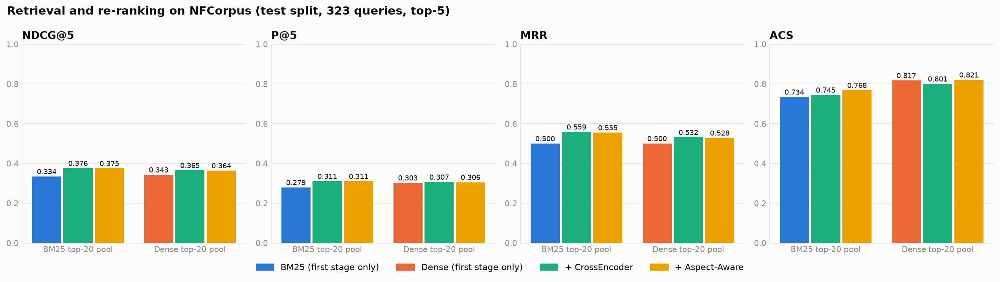
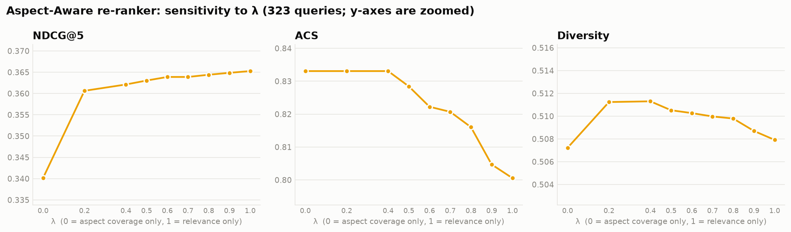

# Aspect-Aware Re-ranking for Retrieval-Augmented Generation

Re-ranking strategies for RAG: a diversity-aware (Aspect-Aware) re-ranker and a cross-encoder re-ranker, compared with BM25 and dense retrieval on the NFCorpus medical benchmark, together with a proposed evaluation metric, the Aspect Coverage Score (ACS).

> Research internship project at MINDS Lab, Indian Institute of Information Technology (IIIT) Kottayam, May–June 2026, under the guidance of Dr. Selvi C.

## Overview

A RAG system retrieves documents and passes them to a language model as context. This project studies the re-ranking stage that sits between the two: given 20 candidate documents, which 5 should the generator see?

It implements and evaluates:

- two first-stage retrievers (BM25 and a dense bi-encoder with FAISS),
- a cross-encoder re-ranker,
- a proposed **Aspect-Aware re-ranker** that trades relevance against coverage of the query's sub-topics,
- a proposed metric, the **Aspect Coverage Score (ACS)**, and
- an end-to-end RAG evaluation with `flan-t5-base` and ROUGE-L.

## Motivation

Retrievers rank each document independently by relevance. The top results therefore often repeat the same information in different words, so the generator receives a narrow context and produces a narrow answer, even when every individual document is relevant.

## Problem statement

1. Relevance-only ranking gives redundant context for multi-faceted queries.
2. Standard metrics (NDCG, MRR, P@k) score documents one at a time, so they cannot detect that redundancy.

## Objectives

- Build a baseline RAG pipeline with BM25 and dense retrieval.
- Add cross-encoder re-ranking.
- Design an Aspect-Aware re-ranker that balances relevance with aspect coverage.
- Propose and evaluate ACS as a set-level retrieval metric.
- Compare the systems on retrieval metrics and on end-to-end answer quality.

## RAG pipeline

```
Query ──► First stage (BM25 or Dense) ──► top-20 candidates
                                              │
                                              ▼
                 Re-ranker (none | CrossEncoder | Aspect-Aware) ──► top-5 documents
                                              │
                                              ▼
                              flan-t5-base ──► answer ──► ROUGE-L
```

## Systems compared

| System | Description |
|---|---|
| BM25 | `BM25Okapi` over lowercased alphanumeric tokens |
| Dense | `all-MiniLM-L6-v2` embeddings (384-d), exact cosine search with FAISS `IndexFlatIP` |
| + CrossEncoder | `cross-encoder/ms-marco-MiniLM-L-6-v2` re-scores the top-20 candidates |
| + Aspect-Aware (proposed) | Greedy selection combining cross-encoder relevance with coverage of new query aspects |

Each re-ranker is applied to both candidate pools (BM25 top-20 and Dense top-20), giving six systems. Within a pool, the first-stage ranking and both re-rankers always see identical candidates.

## Aspect-Aware re-ranking

1. **Aspect extraction** (`src/aspects.py`). Rule-based: strip the leading question word, split on "and" if present, otherwise remove stopwords and short words and pair the remaining content words into bigrams (at most 4 aspects). Example: *"Do Cholesterol Statin Drugs Cause Breast Cancer?"* → `cholesterol statin`, `drugs cause`, `breast cancer`.
2. **Embedding**. Aspects are encoded with the bi-encoder. Candidate document embeddings are looked up from the pre-computed index.
3. **Greedy selection** (`src/rerankers.py`). Until 5 documents are chosen, pick the candidate maximising

   ```
   score = λ · CE_relevance + (1 − λ) · (newly covered aspects / total aspects)
   ```

   `CE_relevance` is the cross-encoder score, min-max normalised over the candidates. A document covers an aspect when their cosine similarity is at least the threshold (default 0.25).

With λ = 1 the method reduces to cross-encoder re-ranking. The default is λ = 0.7.

## Aspect Coverage Score (ACS)

```
ACS = (query aspects covered by at least one of the top-k documents) / (total query aspects)
```

An aspect counts as covered under the same cosine threshold that the re-ranker uses. Both read it from one setting (`ASPECT_SIM_THRESHOLD` in `src/config.py`, or `--threshold` on the command line).

ACS is a heuristic proxy, not a validated measure of answer completeness: it depends on the rule-based aspects and on an empirically chosen threshold. Because the Aspect-Aware re-ranker optimises the same coverage rule that ACS measures, a higher ACS for that system is expected by construction and is not independent evidence of better retrieval.

## Dataset

[NFCorpus](https://www.cl.uni-heidelberg.de/statnlpgroup/nfcorpus/) from the [BEIR](https://github.com/beir-cellar/beir) benchmark: 3,633 medical and nutrition documents, 323 test queries, graded relevance labels (2 = highly relevant, 1 = relevant).

The dataset is **not** stored in this repository. It is downloaded automatically on first run into `data/nfcorpus/`. Each document is represented as `title + ". " + text`.

`data/rag_qa.json` holds 15 question / reference-answer pairs written by the author for the end-to-end experiment.

## Installation

```bash
git clone <repository-url>
cd aspect-aware-rag-reranking
python -m venv .venv
source .venv/bin/activate        # Windows: .venv\Scripts\activate
pip install -r requirements.txt
```

Python 3.10 or newer (the reported results used Python 3.12). A GPU is optional; everything runs on CPU.

## Usage

Run everything (downloads the dataset and models on first use):

```bash
python scripts/run_all.py
```

Or one experiment at a time:

```bash
python scripts/run_retrieval_eval.py     # Experiment 1
python scripts/run_lambda_sweep.py       # Experiment 2
python scripts/run_rag_eval.py           # Experiment 3
```

Useful options: `--num-queries N` (seeded random sample instead of all test queries), `--threshold`, `--lambda`, `--candidates`, `--top-k`, `--seed`. Use `-h` for the full list.

Unit tests for the model-free code:

```bash
python -m unittest discover -s tests
```

## Project structure

```
aspect-aware-rag-reranking/
├── README.md
├── requirements.txt
├── src/
│   ├── config.py          models, hyper-parameters, paths
│   ├── data.py            NFCorpus download and loading
│   ├── retrievers.py      BM25 and dense (FAISS) retrievers
│   ├── aspects.py         query aspect extraction
│   ├── rerankers.py       cross-encoder and Aspect-Aware re-rankers
│   ├── metrics.py         NDCG, P@k, MRR, diversity, ACS, significance test
│   ├── prompting.py       prompt construction within the generator's input limit
│   ├── generation.py      flan-t5 answer generation
│   ├── pipeline.py        seeding, resource loading, per-query ranking
│   ├── experiments.py     the three experiments
│   └── plots.py           figures
├── scripts/               command-line entry points
├── notebooks/             walkthrough notebook
├── tests/                 unit tests
├── data/rag_qa.json       15 hand-written QA pairs
└── results/               CSV results and figures
```

## Experiments

| # | Experiment | Queries | Output |
|---|---|---|---|
| 1 | Six systems on NDCG@5, P@5, MRR, ACS and diversity, with paired randomisation tests | all NFCorpus test queries | `reranking_results.csv`, `reranking_per_query.csv`, `reranking_significance.csv` |
| 2 | λ sweep (0.0 to 1.0) for the Aspect-Aware re-ranker on the dense pool | all NFCorpus test queries | `lambda_analysis.csv` |
| 3 | End-to-end RAG: BM25, Dense, Dense + CrossEncoder, Dense + Aspect-Aware; ROUGE-L F1 against reference answers | 15 hand-written QA pairs | `rag_comparison.csv`, `rag_answers.csv`, `rag_retrieved_docs.csv` |

Reproducibility: a fixed seed (42) for Python, NumPy and PyTorch; deterministic beam search for generation; the number of evaluated queries is logged and written to the result files; `requirements.txt` pins the package versions of the reported run, which are also saved in `results/environment.txt`.

## Results

All numbers below come from the CSV files in `results/`, produced by `python scripts/run_all.py` (seed 42, CPU, package versions in `results/environment.txt`).

### Experiment 1: retrieval and re-ranking (323 test queries, top-5)

| System | NDCG@5 | P@5 | MRR | ACS | Diversity |
|---|---|---|---|---|---|
| BM25 | 0.3344 | 0.2793 | 0.5000 | 0.7343 | **0.5967** |
| BM25 + CrossEncoder | **0.3761** | **0.3108** | **0.5589** | 0.7446 | 0.5677 |
| BM25 + Aspect-Aware | 0.3751 | **0.3108** | 0.5551 | 0.7683 | 0.5680 |
| Dense | 0.3431 | 0.3028 | 0.5004 | 0.8173 | 0.5041 |
| Dense + CrossEncoder | 0.3653 | 0.3065 | 0.5316 | 0.8006 | 0.5079 |
| Dense + Aspect-Aware | 0.3639 | 0.3059 | 0.5285 | **0.8207** | 0.5100 |



Paired randomisation tests (10,000 resamples, `results/reranking_significance.csv`):

| Comparison | NDCG@5 difference | p | ACS difference | p |
|---|---|---|---|---|
| BM25 + Aspect-Aware vs BM25 + CrossEncoder | −0.0010 | 0.58 | +0.0237 | < 0.001 |
| Dense + Aspect-Aware vs Dense + CrossEncoder | −0.0014 | 0.18 | +0.0201 | < 0.001 |
| BM25 + Aspect-Aware vs BM25 | +0.0407 | < 0.001 | +0.0341 | < 0.001 |
| Dense + Aspect-Aware vs Dense | +0.0207 | 0.019 | +0.0034 | 0.50 |

What the results show:

- Cross-encoder re-ranking improves relevance over both first stages. The best NDCG@5, P@5 and MRR belong to BM25 + CrossEncoder.
- Against the cross-encoder on the same candidates, the Aspect-Aware re-ranker raises ACS by about 0.02 at no statistically detectable cost in NDCG@5, P@5 or MRR. This ACS gain is expected by construction, because the re-ranker optimises the coverage rule that ACS measures.
- The effect is narrow. The five metrics differ between the two re-rankers on only 23 (BM25 pool) and 21 (dense pool) of 323 queries; ACS is higher on 12 queries in each pool and never lower. On the remaining queries the cross-encoder's top documents already cover the extracted aspects, so the two methods agree.
- The Aspect-Aware re-ranker does **not** improve ACS over plain dense retrieval (0.8207 vs 0.8173, p = 0.50). Dense retrieval alone already has a higher ACS than Dense + CrossEncoder (0.8006).
- Embedding diversity is highest for plain BM25 and is not meaningfully increased by the Aspect-Aware re-ranker.

### Experiment 2: λ sensitivity (dense pool, 323 queries)

| λ | NDCG@5 | P@5 | MRR | ACS | Diversity |
|---|---|---|---|---|---|
| 0.0 | 0.3401 | 0.3003 | 0.4916 | 0.8331 | 0.5072 |
| 0.2 | 0.3606 | 0.3046 | 0.5189 | 0.8331 | 0.5112 |
| 0.4 | 0.3621 | 0.3046 | 0.5254 | 0.8331 | 0.5113 |
| 0.5 | 0.3630 | 0.3053 | 0.5264 | 0.8284 | 0.5105 |
| 0.6 | 0.3639 | 0.3059 | 0.5280 | 0.8222 | 0.5103 |
| 0.7 | 0.3639 | 0.3059 | 0.5285 | 0.8207 | 0.5100 |
| 0.8 | 0.3644 | 0.3059 | 0.5295 | 0.8160 | 0.5098 |
| 0.9 | 0.3649 | 0.3059 | 0.5316 | 0.8047 | 0.5087 |
| 1.0 | 0.3653 | 0.3065 | 0.5316 | 0.8006 | 0.5079 |



NDCG@5 rises steadily with λ (0.3401 to 0.3653) and ACS falls (0.8331 to 0.8006), so the trade-off exists but is small: about 0.025 NDCG@5 against 0.033 ACS over the whole range. ACS is flat for λ ≤ 0.4. Diversity barely moves (0.507 to 0.511). λ = 1.0 reproduces Dense + CrossEncoder exactly, and the default λ = 0.7 gives up 0.0014 NDCG@5 for 0.020 ACS.

### Experiment 3: end-to-end RAG

**Pending re-run.** After the first full run, the generator input limit was lowered from 1,024 to 512 tokens to respect the maximum input length of `flan-t5-base`. The RAG experiment has to be repeated with this setting (`python scripts/run_rag_eval.py`) before its results are reported here.

### Original internship results (for reference)

These numbers come from the original internship notebook, before the changes listed below. They are not comparable with the refactored code.

| System | NDCG@5 | P@5 | MRR | ACS |
|---|---|---|---|---|
| BM25 | 0.2336 | 0.2120 | 0.3893 | 0.6417 |
| Dense | 0.3625 | 0.3280 | 0.6033 | 0.7417 |
| Dense + CrossEncoder | 0.3889 | 0.3280 | 0.6400 | 0.7267 |
| Dense + Aspect-Aware | 0.3828 | 0.3280 | 0.6167 | 0.7467 |

First 50 test queries, top-5. In that run the end-to-end comparison covered only BM25 (ROUGE-L 0.1144) and Aspect-Aware (0.1249) on 15 queries; the cross-encoder was not part of it.

### Changes from the original notebook

| Change | Why |
|---|---|
| Re-rankers evaluated on both the BM25 and the dense top-20 pool (six systems) | Originally BM25 was a top-5 first-stage result while the re-rankers used the dense pool, so the comparison mixed retriever and re-ranker effects |
| All test queries instead of the first 50 (retrieval) and first 30 (λ sweep) | Larger sample; removes dependence on file order |
| Paired randomisation tests added | To state whether differences are statistically distinguishable |
| Punctuation removed from aspects (`breast cancer?` → `breast cancer`) | Bug fix |
| BM25 tokenises on alphanumeric tokens instead of whitespace | `cancer?` previously failed to match `cancer`, which handicapped the baseline |
| Generator receives all 5 documents, each truncated to an equal share (roughly 90 tokens) of the 512-token input limit of `flan-t5-base` | Originally only the first 3 documents, cut to 800 characters in total, so the context was mostly the first document |
| Dense and Dense + CrossEncoder added to the end-to-end experiment | Needed to compare the re-rankers on answer quality |
| ACS and the re-ranker share one configurable threshold; ACS reported in the λ sweep | Consistency |

## Limitations

- Aspect extraction is rule-based. It drops words shorter than four characters (for example "fat", "tea"), its bigrams do not always correspond to meaningful sub-topics, and queries split on "and" keep their stopwords.
- 192 of the 323 test queries (59%) yield a single aspect. For those, ACS is either 0 or 1 and the Aspect-Aware re-ranker can differ from the cross-encoder only when the most relevant documents miss that one aspect.
- The ACS threshold (0.25) was chosen empirically and ACS has not been validated against human judgements of coverage.
- The Aspect-Aware re-ranker directly optimises the coverage rule that ACS measures.
- NFCorpus relevance labels judge documents individually; the dataset has no aspect-level annotations.
- In the end-to-end experiment each document is truncated to roughly 90 tokens so that five documents fit in the 512-token input of `flan-t5-base`; the generator sees little more than the title and opening sentences.
- The end-to-end experiment uses only 15 queries with reference answers written by the author, a small generator (`flan-t5-base`) and ROUGE-L, which rewards word overlap rather than correctness. Its results are indicative only.
- A single dataset and domain; no comparison with standard MMR.

## Future work

- Query-adaptive λ (factual versus exploratory queries).
- Learned aspect extraction in place of the rules.
- A standard MMR baseline and other diversification methods.
- Larger benchmarks with gold answers (MS MARCO, Natural Questions) and a larger generator.
- A re-ranker trained jointly for relevance and coverage.

## Acknowledgements

This work was carried out during a research internship at MINDS Lab (Machine Intelligence and Data Science Research Lab), IIIT Kottayam, in May–June 2026, under the guidance of Dr. Selvi C.

## References

1. P. Lewis et al., "Retrieval-Augmented Generation for Knowledge-Intensive NLP Tasks," NeurIPS, 2020.
2. R. Nogueira and K. Cho, "Passage Re-ranking with BERT," arXiv:1901.04085, 2019.
3. J. Carbonell and J. Goldstein, "The Use of MMR, Diversity-Based Reranking for Reordering Documents and Producing Summaries," SIGIR, 1998.
4. N. Reimers and I. Gurevych, "Sentence-BERT: Sentence Embeddings using Siamese BERT-Networks," EMNLP, 2019.
5. S. Robertson and H. Zaragoza, "The Probabilistic Relevance Framework: BM25 and Beyond," Foundations and Trends in Information Retrieval, 2009.
6. N. Thakur et al., "BEIR: A Heterogeneous Benchmark for Zero-shot Evaluation of Information Retrieval Models," NeurIPS Datasets and Benchmarks, 2021.
7. V. Boteva et al., "A Full-Text Learning to Rank Dataset for Medical Information Retrieval," ECIR, 2016.
